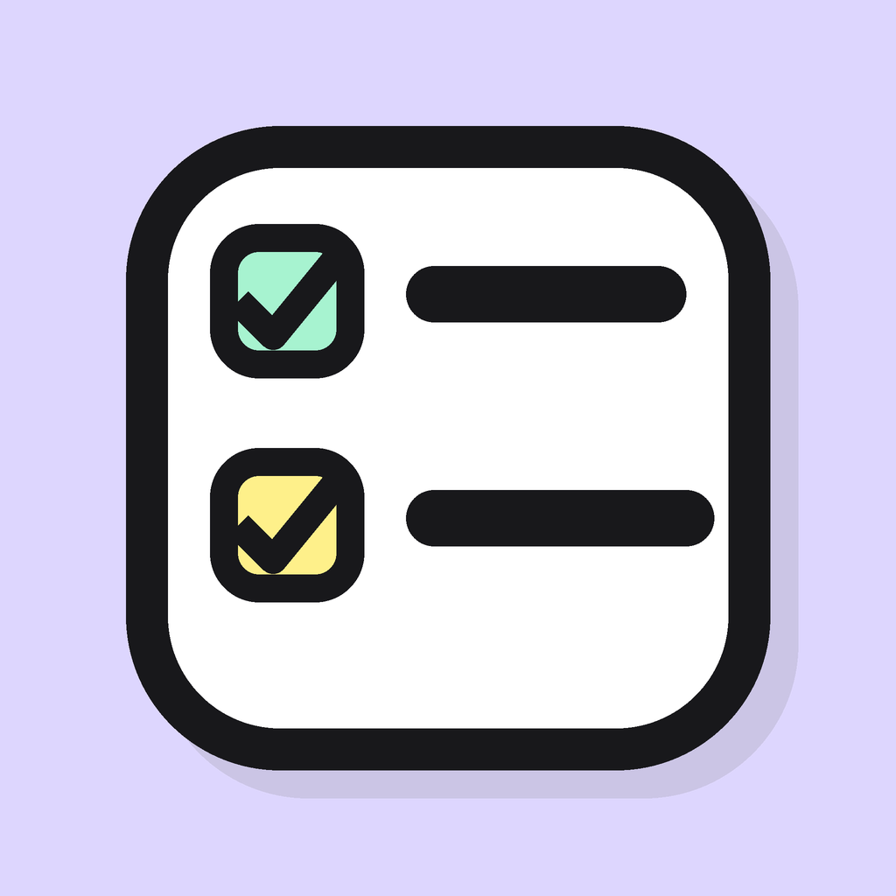
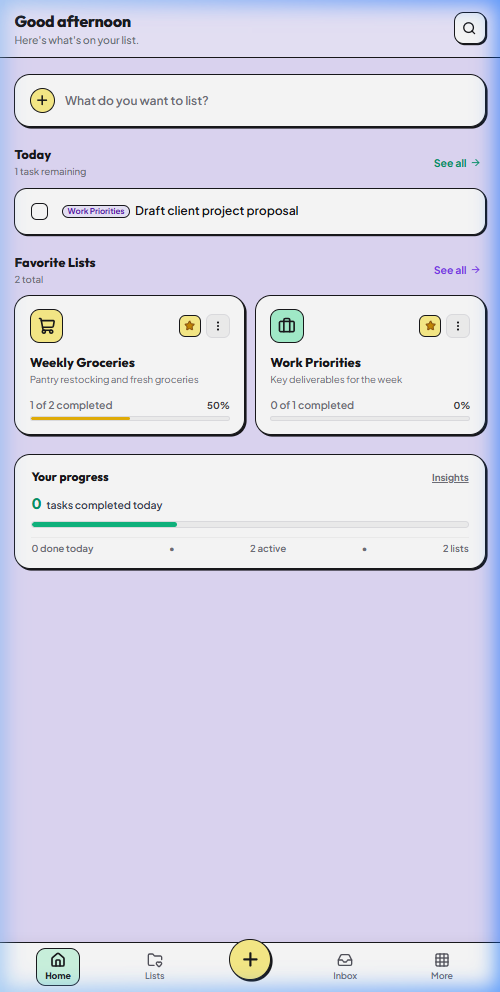
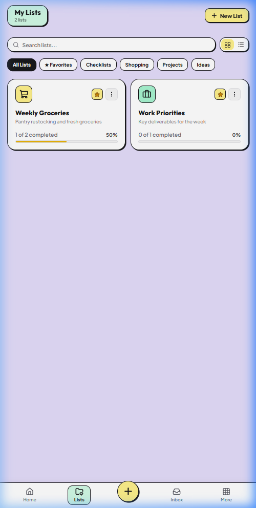
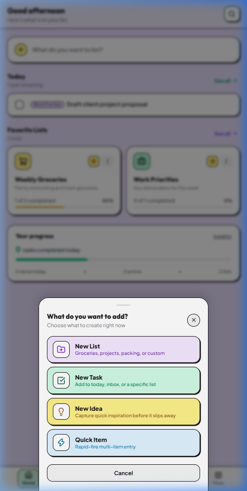
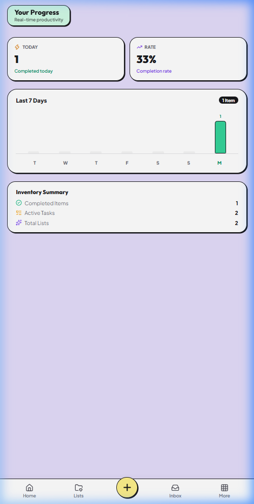

<div align="center">

  

  # List It
  ### Universal Task & List Manager with Tactile Micro-Interactions

  <p align="center">
    A cheerful, pastel neo-brutalist productivity app designed to keep your thoughts, projects, daily focus, and groceries effortlessly organized with delightful tactile feedback.
  </p>

  <p align="center">
    <a href="https://list-it-rust.vercel.app/" target="_blank">
      
    </a>
    <a href="https://expo.dev/accounts/raj690/projects/list-it/builds/8f0f5e28-0590-40b9-86a0-74f2090d8e75" target="_blank">
      
    </a>
    
    
  </p>

</div>

---

## 📱 App Preview

<div align="center">
  <table>
    <tr>
      <td align="center" width="25%">
        
        <br />
        <b>🏠 Home Dashboard</b>
        <br />
        <sub>Daily focus, stats & active lists</sub>
      </td>
      <td align="center" width="25%">
        
        <br />
        <b>📂 Category Hub</b>
        <br />
        <sub>Multi-category lists & filters</sub>
      </td>
      <td align="center" width="25%">
        
        <br />
        <b>⚡ Quick Creation</b>
        <br />
        <sub>Tactile speed-entry sheet</sub>
      </td>
      <td align="center" width="25%">
        
        <br />
        <b>📊 Live Insights</b>
        <br />
        <sub>Weekly completion trends & metrics</sub>
      </td>
    </tr>
  </table>
</div>

---

## ✨ Key Features

### 🎨 Playful Pastel Neo-Brutalist Design
- **Signature Lavender Aesthetic**: Curated lavender purple theme (`#DDD6FE`, `#EDE9FE`) with high-contrast neo-brutalist borders and tactile button press animations.
- **Micro-Animations**: Fluid card transitions, bounce chips, and celebratory confetti upon completing list milestones.

### 🎵 Custom Synthesized Web Audio Engine
- **Hardware-Calibrated Audio**: Built-in Web Audio API synthesizer that produces crisp, tactile woodblock pops, celebratory chords, and subtle chimes without downloading external MP3s.
- **Mobile Speaker Optimized**: Tuned acoustic frequencies (820Hz $\rightarrow$ 320Hz drops) designed specifically to cut clearly through smartphone speakers.
- **Haptic Feedback**: Synchronized with device vibration for a satisfying physical click sensation.

### ⚡ Smart Productivity Workflows
- **Universal List Types**: Checklists, shopping lists, multi-stage projects, and quick idea capture.
- **Organized Sections & Subtasks**: Break complex tasks into progressive checklists with visual progress indicators.
- **Date Awareness**: Automatically highlights overdue items, due-today tasks, and upcoming deadlines.
- **Fast Search & Filter Chips**: Instant fuzzy filtering by category, favorite status, tags, and keywords.

### 🔒 100% Offline-First Privacy
- All lists, notes, tags, and settings are stored locally on your device via persistent local storage.
- Zero tracking, zero telemetry, no mandatory sign-ups, and 100% functional without an internet connection.
- Full backup & export capabilities (JSON & CSV import/export).

---

## 🛠️ Technology Stack

| Layer | Technologies |
| :--- | :--- |
| **Frontend Web** | React 19, TypeScript, Vite 5, Vanilla CSS Design System |
| **Mobile Runtime** | React Native 0.86, Expo SDK 57, React Native WebView |
| **Icons & Media** | Lucide React, HTML5 Canvas Confetti |
| **Audio & Haptics** | Native Web Audio API Synthesizer, Web Vibration API |
| **State & Storage** | Zustand with LocalStorage Persistence |
| **Build & Deploy** | Vercel (Web Hosting), Expo EAS Build (Android Standalone APK) |

---

## 🚀 Quick Start

### 1. Clone & Install Dependencies
```bash
git clone https://github.com/Raj-AI-Tech/List-it.git
cd List-it
npm install
```

### 2. Run the Web App (Vite)
```bash
npm run dev
```
Open [http://localhost:5173](http://localhost:5173) in your browser.

### 3. Run on Mobile Device via Expo Go
```bash
npx expo start -c
```
Scan the displayed QR code with the **Expo Go** app on your Android or iOS device.

---

## 📦 Building Standalone Android APK

This project is pre-configured with **Expo EAS Build** to create installable `.apk` packages:

```bash
# 1. Log in to your Expo account
npx eas login

# 2. Trigger the cloud APK build
npx eas build --platform android --profile preview
```

Once the cloud build finishes, download the generated APK from the printed terminal link or scan the QR code to install it directly on your Android phone.

---

## 🌐 Live Deployments

- **Web Application**: [https://list-it-rust.vercel.app/](https://list-it-rust.vercel.app/)
- **Latest Android APK Build**: [Expo Build Download](https://expo.dev/accounts/raj690/projects/list-it/builds/8f0f5e28-0590-40b9-86a0-74f2090d8e75)
- **Source Code**: [https://github.com/Raj-AI-Tech/List-it](https://github.com/Raj-AI-Tech/List-it)

---

<div align="center">
  <sub>Crafted with precision, pastel vibes, and tactile micro-interactions.</sub>
</div>
